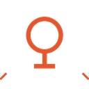
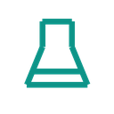
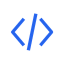
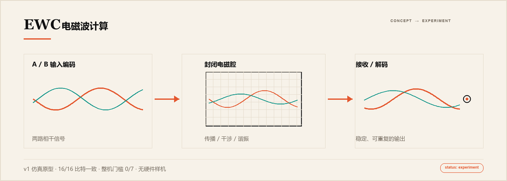
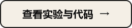
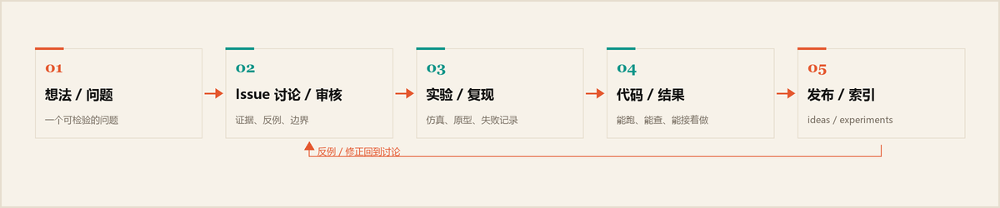

<p align="center">
  <picture>
    <source media="(prefers-color-scheme: dark)" srcset="assets/hero-dark.png">
    <source media="(prefers-color-scheme: light)" srcset="assets/hero-light.png">
    
  </picture>
</p>

<p align="center">
  <a href="LICENSE"></a>
  <a href="LICENSE-CONTENT.md"></a>
  <a href="docs/ROADMAP.md"></a>
  <a href=".github/CONTRIBUTING.md"></a>
</p>

<p align="center">
  <strong>记录经审核发布的 AI、科技、技术、技巧与思想，并链接相关实验和代码。</strong><br />
  <sub>从一个问题或想法出发，通过讨论、证据和可复现实验不断检验、修正认识。</sub>
</p>

## 这是什么

**0-1 是一个公开的“想法 → 实验 → 代码”索引。** 这里记录经审核发布的想法、批评与反例，并链接可复现的实验、原型和代码。投稿需要审核；发布内容会标注状态，区分事实、推断与猜测。

<table>
  <tr>
    <td align="center" width="33%">
      <br />
      <strong>想法 / Ideas</strong><br />
      <sub>把问题写清楚，接受批评、反例与证伪</sub>
    </td>
    <td align="center" width="33%">
      <br />
      <strong>实验 / Experiments</strong><br />
      <sub>可复现的仿真、原型与失败记录</sub>
    </td>
    <td align="center" width="33%">
      <br />
      <strong>代码 / Code</strong><br />
      <sub>能跑、能查、能接着做</sub>
    </td>
  </tr>
</table>

## 重点项目：EWC 电磁波计算

<p align="center">
  <picture>
    <source media="(prefers-color-scheme: dark)" srcset="assets/ewc-dark.png">
    <source media="(prefers-color-scheme: light)" srcset="assets/ewc-light.png">
    
  </picture>
</p>

**把电磁波的物理演化过程直接当作计算。** 在一个受控的封闭电磁腔中，多路编码电磁波发生传播、干涉、谐振与耦合；如果输出稳定、可重复且可编程，就把这段物理过程定义为一次计算。

| v1 仿真原型 | 整机验收门槛 | 硬件样机 |
|:---:|:---:|:---:|
| **16 / 16** 比特一致 | **0 / 7** | **未开始** |

<p align="center">
  <a href="ideas/electromagnetic-wave-computing.md"></a>
  &nbsp;&nbsp;
  <a href="experiments/ewc-electromagnetic-wave-computing.md"></a>
</p>

<sub>当前状态：`status:experiment`。16/16 是特定端口、负载、步数与离线判决下的仿真原型结果，不关闭整机门槛，也不构成硬件、速度或能效证据。</sub>

## 工作方式

<p align="center">
  <picture>
    <source media="(prefers-color-scheme: dark)" srcset="assets/flow-dark.png">
    <source media="(prefers-color-scheme: light)" srcset="assets/flow-light.png">
    
  </picture>
</p>

<sub>想法先进入 Issue 讨论与审核，再进入实验 / 复现；代码与结果通过 PR 关联，反例与修正回到讨论。</sub>

## 已发布内容

| 类型 | 条目 | 状态 | 入口 |
|---|---|---|---|
| 想法 | 电磁波物理计算机构想（EWC） | `status:experiment` | [阅读](ideas/electromagnetic-wave-computing.md) |
| 实验 / 原型 | EWC 电磁波计算实验 | `status:experiment` | [条目](experiments/ewc-electromagnetic-wave-computing.md) · [代码与报告](experiments/ewc/README.md) |

> 更多条目会在通过审核后补充；当前目录不代表已经有大量成果。

## 如何参与

1. **提出想法**：在 [Issues](https://github.com/End-Loser/0-1/issues/new/choose) 使用对应模板说明问题、依据、反例与验证方法。
2. **提交实验或代码**：先读 [投稿与审核指南](.github/CONTRIBUTING.md) 与 [项目上传检查清单](docs/SUBMISSION_CHECKLIST.md)，再 Fork 并提交 PR。
3. **接手实现**：从 [Issue #1](https://github.com/End-Loser/0-1/issues/1) 认领 MVE-1 / 开放任务，或直接对想法条目提出反例。

## 项目结构

```text
.github/           投稿/审核/安全/行为准则与模板
assets/            首页横幅、概念图与按钮素材
docs/              路线图与项目上传检查清单
experiments/       实验、原型与复现说明
  ewc/             EWC 代码、报告与结果摘要
ideas/             经审核的想法、批评和反例
```

## 规则、状态与许可

<details>
<summary><strong>展开：投稿规则、状态标签、内容边界与许可</strong></summary>

### 投稿与审核

- [投稿与审核指南](.github/CONTRIBUTING.md)
- [项目上传检查清单](docs/SUBMISSION_CHECKLIST.md)
- [行为准则](.github/CODE_OF_CONDUCT.md)
- [安全与负责任披露](.github/SECURITY.md)
- [路线图](docs/ROADMAP.md)

### 状态标签

- `status:draft`：草案或待审核
- `status:discussion`：讨论中
- `status:experiment`：验证中
- `status:verified`：有可复现证据支持
- `status:revised`：已修正
- `status:refuted`：当前证据不支持原假设
- `needs-info`：需要补充信息
- `risk:needs-review`：需要额外安全或隐私审核

### 内容边界

不接受违法或危险内容、骚扰、诈骗、侵犯隐私、未经授权的数据或系统操作、抄袭及无权分发的材料。请勿提交密码、API 密钥、Token 或其他秘密信息。

### 许可

- 原创代码：[MIT](LICENSE)
- 文字、文档、图片和整理的数据：[CC BY 4.0](LICENSE-CONTENT.md)
- 第三方材料保留各自许可证；未明确标注许可的第三方材料不应被默认视为可自由使用。

</details>

---

<p align="center">
  <sub>MIT · CC BY 4.0 · 由 End-Loser 维护 · <a href="https://github.com/End-Loser/0-1/issues">Issues</a> · <a href="https://github.com/End-Loser/0-1/pulls">Pull requests</a></sub>
</p>
