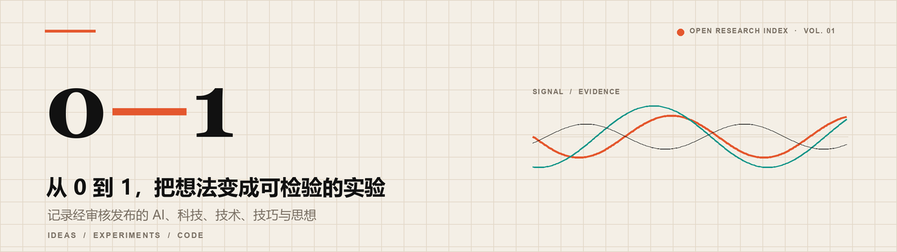

<h1 align="center">把想法放进来，让它被看见、被讨论、被实现</h1>

<p align="center">
  <strong>不必完整，不必正确。先说出来，再一起验证。</strong><br />
  <sub>0-1 是一个公开的“想法 → 讨论 → 实验 → 代码”索引。你可以只带一个问题来。</sub>
</p>

<p align="center">
  <a href="https://github.com/End-Loser/0-1/discussions/new?category=ideas"></a>
  &nbsp;&nbsp;
  <a href="#精选条目"></a>
</p>

<p align="center">
  <sub>想被正式收录？<a href="https://github.com/End-Loser/0-1/issues/new?template=idea.yml">填 Issue 表单</a> · 讨论区即时公开 · 进入 <code>ideas/</code> 需审核 · 代码与实验走 PR</sub>
</p>

<p align="center">
  <picture>
    <source media="(prefers-color-scheme: dark)" srcset="assets/hero-dark.png">
    <source media="(prefers-color-scheme: light)" srcset="assets/hero-light.png">
    
  </picture>
</p>

## 精选条目

<table>
  <tr>
    <td width="33%" valign="top">
      <strong>EWC 电磁波计算</strong><br />
      <sub>把电磁波的物理演化直接当作计算。</sub><br /><br />
      <code>status:experiment</code><br /><br />
      <a href="ideas/electromagnetic-wave-computing.md">读想法</a> ·
      <a href="experiments/ewc-electromagnetic-wave-computing.md">看实验</a> ·
      <a href="https://github.com/End-Loser/0-1/issues/1">讨论 / 认领</a>
    </td>
    <td width="33%" valign="top">
      <strong>CVNS 小说写作</strong><br />
      <sub>把长篇小说纵向拆成变量线，让冲突变成设计资源。</sub><br /><br />
      <code>status:experiment</code><br /><br />
      <a href="ideas/micro-task-variable-line-novel-writing.md">读想法</a> ·
      <a href="experiments/cvns-micro-prompt-skill.md">看代码</a> ·
      <a href="experiments/cvns-micro-prompt-skill/docs/origin/ORIGIN.md">原始思路</a>
    </td>
    <td width="33%" valign="top">
      <strong>你的想法</strong><br />
      <sub>一句话也可以。这里还空着，第一张新卡片可以是你。</sub><br /><br />
      <sub>等待第一个投稿</sub><br /><br />
      <a href="https://github.com/End-Loser/0-1/discussions/new?category=ideas">说出来</a> ·
      <a href="https://github.com/End-Loser/0-1/issues/new?template=idea.yml">正式投稿</a>
    </td>
  </tr>
</table>

<p align="center"><sub>精选条目由维护者整理；最新讨论在 <a href="https://github.com/End-Loser/0-1/discussions">Discussions</a>。</sub></p>

## 30 秒说出你的想法

1. **点“说出我的想法”** → 进入 Discussions 的 Ideas 分类，写标题和正文。一句话、一个问题、一个反例都可以，不需要先写完整设计书。
2. **有材料就附上** → 图片、视频、文件可在提交后的 Issue 正文中直接拖入；讨论区可贴链接。大文件、长视频或语音请贴外链；GitHub 附件有格式和大小限制。
3. **想被正式收录** → 点“正式投稿”填 Issue 表单；通过审核后会整理进 `ideas/`，并保留署名。

> 讨论区即时公开，但不等于收录；进入 `ideas/` 的内容会经过审核、整理和状态标注。

## 做实验或写代码

- **认领任务**：从 [Issue #1](https://github.com/End-Loser/0-1/issues/1) 的 MVE-1 / 开放任务开始，或对你感兴趣的想法提出反例。
- **提交实验**：用[实验模板](https://github.com/End-Loser/0-1/issues/new?template=experiment.yml)说明对应想法、运行环境、依赖、复现步骤、测试结果和限制。
- **提交代码**：先读[投稿与审核指南](.github/CONTRIBUTING.md)和[项目上传检查清单](docs/SUBMISSION_CHECKLIST.md)，再 Fork + PR，关联对应想法或 Issue。

## 这是什么

**0-1 是一个公开的“想法 → 讨论 → 实验 → 代码”索引。** 这里记录经审核发布的想法、批评与反例，并链接可复现的实验、原型和代码。发布内容会标注状态，区分事实、推断与猜测；你可以从一句话开始，不必先有完整方案。

## 重点项目：EWC 电磁波计算

<p align="center">
  <picture>
    <source media="(prefers-color-scheme: dark)" srcset="assets/ewc-dark.png">
    <source media="(prefers-color-scheme: light)" srcset="assets/ewc-light.png">
    
  </picture>
</p>

**把电磁波的物理演化过程直接当作计算。** 在一个受控的封闭电磁腔中，多路编码电磁波发生传播、干涉、谐振与耦合；如果输出稳定、可重复且可编程，就把这段物理过程定义为一次计算。

| v1 仿真原型 | 整机验收门槛 | 硬件样机 |
|:---:|:---:|:---:|
| **16 / 16** 比特一致 | **0 / 7** | **未开始** |

<p align="center">
  <a href="ideas/electromagnetic-wave-computing.md"></a>
  &nbsp;&nbsp;
  <a href="experiments/ewc-electromagnetic-wave-computing.md"></a>
</p>

<sub>当前状态：`status:experiment`。16/16 是特定端口、负载、步数与离线判决下的仿真原型结果，不关闭整机门槛，也不构成硬件、速度或能效证据。讨论与认领入口见 [Issue #1](https://github.com/End-Loser/0-1/issues/1)。</sub>

## 工作方式

<p align="center">
  <picture>
    <source media="(prefers-color-scheme: dark)" srcset="assets/flow-dark.png">
    <source media="(prefers-color-scheme: light)" srcset="assets/flow-light.png">
    
  </picture>
</p>

<sub>讨论区承接半成品想法；准备正式推进时，再进入 Issue 审核、实验 / 复现、代码 / 结果与发布。反例和修正回到讨论。</sub>

## 全部条目

| 类型 | 条目 | 状态 | 入口 |
|---|---|---|---|
| 想法 | 电磁波物理计算机构想（EWC） | `status:experiment` | [阅读](ideas/electromagnetic-wave-computing.md) |
| 实验 / 原型 | EWC 电磁波计算实验 | `status:experiment` | [条目](experiments/ewc-electromagnetic-wave-computing.md) · [代码与报告](experiments/ewc/README.md) |
| 想法 | 微任务变量线长篇小说写作（CVNS R-06.2） | `status:experiment` | [阅读](ideas/micro-task-variable-line-novel-writing.md) |
| 实验 / 工具 | CVNS R-06.2 小说写作 Skill v1.7.0：设计、代码与问题记录 | `status:experiment` | [条目](experiments/cvns-micro-prompt-skill.md) · [代码与提示词](experiments/cvns-micro-prompt-skill/README.md) |

> 更多条目会在通过审核后补充；当前目录不代表已经有大量成果。最新讨论见 [Discussions](https://github.com/End-Loser/0-1/discussions)。

## 项目结构

```text
.github/           投稿/审核/安全/行为准则与模板
assets/            首页横幅、概念图与按钮素材
docs/              路线图与项目上传检查清单
experiments/       实验、原型与复现说明
  ewc/             EWC 代码、报告与结果摘要
ideas/             经审核的想法、批评和反例
```

## 规则、状态与许可

<details>
<summary><strong>展开：投稿规则、状态标签、内容边界与许可</strong></summary>

### 讨论区与收录

- 讨论区内容即时公开，适合问题、意见和半成品想法；维护者可编辑、隐藏或关闭违规内容。
- 进入 `ideas/` 或 `experiments/` 的内容需要审核、整理和状态标注；讨论不等于收录。
- 图片、视频、文件请确保有权公开且不含隐私；大文件请用外链，语音建议附文字摘要。

### 投稿与审核

- [投稿与审核指南](.github/CONTRIBUTING.md)
- [项目上传检查清单](docs/SUBMISSION_CHECKLIST.md)
- [行为准则](.github/CODE_OF_CONDUCT.md)
- [安全与负责任披露](.github/SECURITY.md)
- [路线图](docs/ROADMAP.md)

### 状态标签

- `status:draft`：草案或待审核
- `status:discussion`：讨论中
- `status:experiment`：验证中
- `status:verified`：有可复现证据支持
- `status:revised`：已修正
- `status:refuted`：当前证据不支持原假设
- `needs-info`：需要补充信息
- `risk:needs-review`：需要额外安全或隐私审核

### 内容边界

不接受违法或危险内容、骚扰、诈骗、侵犯隐私、未经授权的数据或系统操作、抄袭及无权分发的材料。请勿提交密码、API 密钥、Token、他人隐私或未经授权的人像 / 录音 / 视频。

### 许可

- 原创代码：[MIT](LICENSE)
- 文字、文档、图片和整理的数据：[CC BY 4.0](LICENSE-CONTENT.md)
- 第三方材料保留各自许可证；未明确标注许可的第三方材料不应被默认视为可自由使用。

</details>

---

<p align="center">
  <a href="LICENSE"></a>
  <a href="LICENSE-CONTENT.md"></a>
  <a href="https://github.com/End-Loser/0-1/discussions"></a>
</p>

<p align="center">
  <sub>MIT · CC BY 4.0 · 由 End-Loser 维护 · <a href="https://github.com/End-Loser/0-1/discussions">Discussions</a> · <a href="https://github.com/End-Loser/0-1/issues">Issues</a> · <a href="https://github.com/End-Loser/0-1/pulls">Pull requests</a></sub>
</p>
