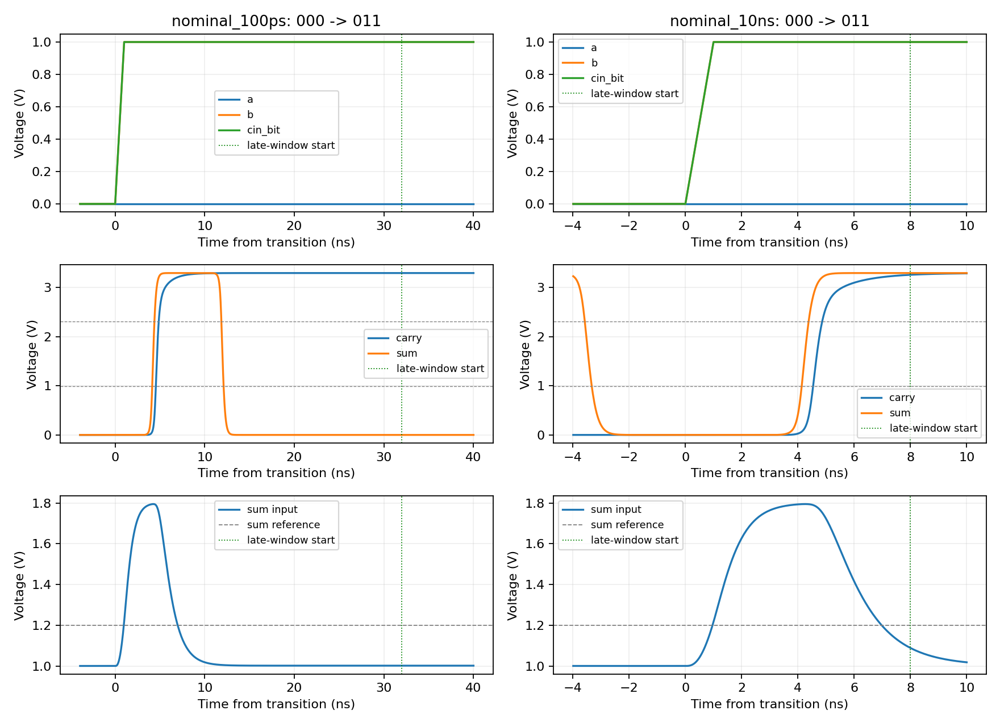

# 第七轮：实际进位抵消链与采样时序验证

日期：2026-11-17。求解器：ngspice-47 Windows console / KLU。

## 1. 本轮推进了什么

第六轮的两个判决通道独立接受预先算好的保持电压。本轮取消第二通道的预设和位信号：

```text
三路输入比特
  → 第一阶段线性叠加接口
  → 晶体管进位判决与电平再生
  → 实际进位输出电压驱动抵消支路
  → 第二阶段线性叠加/抵消接口
  → 晶体管和位判决与电平再生
```

ngspice连续求解这条因果链；第二阶段不使用软件计算的进位或和位作为驱动。
它是**进位驱动的前向级联**，不是把输出绕回自身形成振荡闭环。

**重要边界：本轮电磁叠加和抵消由理想线性受控电压源表示，参数来自已有FDTD投影。**
本轮没有推进连续电磁场，没有实现RF检波、波再发射或真实相移器。
因此本轮证明的是基带因果模型可工作，不能据此证明“电磁场承担主要计算”已实现。

## 2. 主要结果

- 144/144个完整单比特静态状态通过，每项同时检查进位与和位，共288个输出判决。
- 每组连续瞬态覆盖8状态之间全部64种有向跳转，包括保持同一状态；65个状态周期，共130个输出检查。
- 名义1 pF负载、20 ns周期：130/130通过；10 ns周期：106/130通过。
- 20 pF负载、40 ns周期：130/130通过；20 ns周期：106/130通过。
- 组合扰动、40 ns周期：单点采样130/130，但末段稳定窗口只有121/130，按严格规则判为未全部通过。
- 相同组合扰动改为50 ns周期：130/130通过，末段最小输出电平裕量约0.64821 V。
- 关闭抵消支路的负对照：106/130，证明不能把普通阈值输出误当作完整和位计算。

保留了全部失败。没有通过修改真值或硬编码输出获得“全通过”。

**仍不能宣称实物零错误或整机四则运算已经通过。**
本轮没有多位进位链、保持寄存器、时钟电路、四则运算控制器或射频联合求解。

## 3. 固定线性接口与实际进位

从第五轮两种FDTD条件的8个门状态，分别拟合两个传播阶段的固定增益：

| 条件 | A增益 | B增益 | C增益 |
|---|---:|---:|---:|
| 名义 | 1 | 1 | 1 |
| εr+1% | 0.9756186649163 | 0.9756186649163 | 1.03184304579075 |

两阶段拟合的最大残差约10⁻¹⁵逻辑单位。这是重建既有线性投影的一致性，不是实物精度。
各系数固定进入网表，不随着待测输入或目标答案变化。

设a、b、cin为0/1输入，第一阶段保持电压：

```text
V1 = 1.0 V + 0.4 V × (g1A·a + g1B·b + g1C·cin)
进位参考 = 1.6 V
```

第二阶段驱动：

```text
V2 = 1.0 V + 0.4 V × (g2A·a + g2B·b + g2C·cin)
     − 0.8 V × g2C × Vcancel / 3.3 V
和位参考 = 1.2 V
```

Vcancel来自**实际MOS进位输出**经过1 kΩ / 1 pF支路后的电压，支路还对进位缓冲形成真实电容负载。
3.3 V是固定设计标定值；3.0 V供电测试没有把分母自动改成3.0 V。因此输出电平降低会直接改变抵消幅度。
网表中使用线性VCVS实现上述比例，没有`if`、取整、查整题答案或理想逻辑比较器。

名义静态例子：

| 输入 | 第一阶段输入 | 实际进位输出 | 第二阶段输入 | 和位 |
|---|---:|---:|---:|---:|
| 000 | 1.00000 V | 约0 V | 1.00000 V | 0 |
| 001 | 1.40000 V | 约0 V | 1.40000 V | 1 |
| 011 | 1.80000 V | 3.29431935 V | 1.00137713 V | 0 |
| 111 | 2.20000 V | 3.29431935 V | 1.40137713 V | 1 |

剩余对称状态同样验证。进位高电平不等于精确3.3 V，导致少量抵消残差，但在本模型静态裕量内。

## 4. 器件与时间假设

复用第六轮每通道9个MOS的差分对、电流镜、有限晶体管尾偏置和两级CMOS反相器。
共享120 kΩ / 27 kΩ供电偏置分压器。输入RC、比较节点电容、输出100 kΩ负载均保留。
器件是通用Level-1 MOS及固定外加电容，温度模型沿用第六轮明确的VTO、KP参数规律，不是实测PDK。

新增：

- 每条线性输入路径：1 kΩ电阻、0.5 pF电容，时间常数0.5 ns。
- 进位抵消路径：1 kΩ、1 pF，时间常数1 ns。
- 输入跳变采用1 ns线性过渡。
- 偏斜测试让A、B、cin分别延后0、2、4 ns切换。

**这些RC时间常数是工程假设，不是从FDTD脉冲响应提取的真实射频建立时间。**
第五轮两个阶段分别零场初始化，不能把其标量增益当作连续场记忆模型。
所以本轮20/40/50 ns周期只描述这个基带模型，不是已验证的实际电磁传播或整机周期。

## 5. 验收方法

静态：9器件工况×2个FDTD标定条件×8状态，共144项。
器件工况为名义300 K、共同270 K、共同330 K、3.0 V供电、输入VTO±6.5 mV、
输入KP+10%、电流镜一侧KP+10%、仅输入管330 K。每工况16/16通过。
静态还检查比较节点、尾节点和输出位于供电范围内。

连续测试使用完整8状态有向图的欧拉路径。
一次仿真只由初始工作点启动一次，之后65个状态周期连续运行，不在各状态间重新初始化。
每种有向跳转只在该连续历史中出现一次，不是无限重复或全部可能历史的保证。

输出有效范围：

```text
0：Vout ≤ 0.3Vdd
1：Vout ≥ 0.7Vdd
```

每次输出同时满足：

1. 在周期90%时刻采样正确。
2. 周期最后20%的全部保存时间点保持在正确有效区间。

建立时间：从状态开始，到输出进入正确区间并在本周期后续数据点中不再离开。
它包含输入过渡、路径RC、进位判决、抵消RC与和位判决，不是单个比较器的产品延迟。
未建立的输出不能被排除后用剩余最短时间推导可靠频率。

真值只用于结果对照：

```text
k = a + b + cin
期望进位 = [k ≥ 2]
期望和位 = k mod 2
```

## 6. 全部连续结果

每行130个输出检查，严格规则同时检查采样点和末段稳定窗口。

| 工况 | 周期 | 通过 | 最长观测建立时间 | 平均Vdd功率 |
|---|---:|---:|---:|---:|
| 名义1 pF，TRAP最大步200 ps | 40 ns | 130/130 | 13.29955 ns | 1.18943 mW |
| 名义1 pF，TRAP最大步100 ps | 40 ns | 130/130 | 13.30692 ns | 1.18943 mW |
| 名义1 pF，TRAP最大步50 ps | 40 ns | 130/130 | 13.30500 ns | 1.18940 mW |
| 名义1 pF，Gear最大步100 ps | 40 ns | 130/130 | 13.29820 ns | 1.18933 mW |
| 名义1 pF | 20 ns | 130/130 | 13.29964 ns | 1.74581 mW |
| 名义1 pF | 10 ns | **106/130** | 24项周期内未建立 | 2.85746 mW |
| εr+1%标定 | 40 ns | 130/130 | 13.40505 ns | 1.18814 mW |
| 名义20 pF | 40 ns | 130/130 | 26.69757 ns | 4.18957 mW |
| 名义20 pF | 20 ns | **106/130** | 24项周期内未建立 | 7.67529 mW |
| 仅输入管330 K，1 pF | 40 ns | 130/130 | 13.39458 ns | 1.21184 mW |
| 3.0 V供电，1 pF | 40 ns | 130/130 | 17.58797 ns | 1.01482 mW |
| 输入偏斜0/2/4 ns，1 pF | 40 ns | 130/130 | 16.84221 ns | 1.25216 mW |
| 抵消增益+10%，1 pF | 40 ns | 130/130 | 13.42421 ns | 1.19076 mW |
| 组合扰动，20 pF | 40 ns | **121/130** | 34.76661 ns | 3.49040 mW |
| 同一组合扰动，20 pF | 50 ns | **130/130** | 34.74475 ns | 2.88863 mW |
| 负对照：抵消增益为0 | 40 ns | **106/130** | 24项周期内未建立 | 1.03178 mW |

组合扰动同时施加：

- εr+1%的既有投影增益；
- 输入VTO+6.5 mV、仅输入管330 K；
- 3.0 V供电、20 pF输出负载；
- A/B/cin前向路径增益乘以1.05/0.95/1.05；
- 抵消支路增益额外增加5%。

这是一个指定组合点，不是所有误差符号的最坏情况穷举。
40 ns周期时，最后20%窗口从32 ns开始，但最长建立时间约34.77 ns；
90%采样在36 ns，因而单点检查会漏掉窗口前段的不稳定。
50 ns周期时窗口从40 ns开始，实测最长建立约34.74 ns，最小末段电平裕量约0.64821 V。
这给出约5.26 ns的观测建立时间余量，但不是实物时钟抖动容限或跨工艺保证。

## 7. 毛刺为何必须处理

即使期望和位不变，仍可能发生短暂错误脉冲：

- `000 → 011`：期望和位一直为0，但第一阶段叠加先增加，进位尚未升高，第二阶段暂时越过和位阈值。
- `111 → 001`：期望和位一直为1，但进位尚未下降时，旧抵消量使第二阶段暂时偏低。

名义40 ns序列有6个“期望输出未改变却离开有效区间”的输出窗口。
名义最慢窗口是`111 → 001`的和位，约13.30692 ns。
这些毛刺在末段采样前消失，所以本轮末段可以通过；它们没有被硬件锁存器消除。



因此“原始输出随时都正确”不成立。
下一步需要真正的保持/采样寄存器、相位控制与有效标志，让下游只在已验证时刻接受结果。
仅延长周期改善了本次采样裕量，不会让组合逻辑从此没有毛刺。

## 8. 数值一致性

最大时间步200/100/50 ps，采用ngspice自适应TRAP；另用Gear交叉检查。
不是严格固定采样间隔。比较时在左侧数据时间点插值右侧波形。

| 比较 | 进位波形最大差 | 和位波形最大差 | Vdd能量相对差 |
|---|---:|---:|---:|
| 200 ps TRAP / 100 ps TRAP | 2.04193 mV | 3.46360 mV | 0.00049880% |
| 100 ps TRAP / 50 ps TRAP | 3.45222 mV | 7.74214 mV | 0.00233082% |
| 100 ps TRAP / 100 ps Gear | 4.42624 mV | 12.93517 mV | 0.00834656% |

四组名义输出均130/130，毛刺窗口数均6。
完整波形最大差不单调减小，所以不宣称已达到某个高阶收敛精度。
比较只支持本次判决与能量对所测数值设置的稳定性，不等于器件或实物误差界。
组合扰动50 ns目前只测100 ps最大步TRAP，未完成该组合点的步长和方法交叉检查。

独立核验脚本不重新调用原测量函数，重新计算真值、静态抵消关系、采样插值、末段裕量、建立时间、
毛刺窗口数及供电积分，并确认64种有向跳转和断开抵消的负对照。
归档一致性PASS不代表失败工况通过，也不等于实物认证。

## 9. 局部能量和速度

```text
PVdd(t) = −Vdd × I(Vdd,t)
EVdd = ∫ PVdd(t) dt
```

| 工况 | 序列时长 | 序列Vdd能量 | 按65个状态周期摊分 |
|---|---:|---:|---:|
| 名义1 pF，40 ns，最大步100 ps | 2.60 μs | 3.09251 nJ | 47.5771 pJ/周期 |
| 名义1 pF，20 ns | 1.30 μs | 2.26955 nJ | 34.9162 pJ/周期 |
| 名义20 pF，40 ns | 2.60 μs | 10.89287 nJ | 167.5827 pJ/周期 |
| 组合扰动20 pF，50 ns | 3.25 μs | 9.38804 nJ | 144.4313 pJ/周期 |

名义40 ns序列峰值供电约42.7000 mW，平均约1.18943 mW。
同一个电路更快运行时平均功率增加，而较慢周期摊分能量因静态偏置时间较长而增加。
改变输入序列、占空比、负载和最终电容状态会改变积分，不能把上述值当成与数据无关的常数。
这里是供电输入能量，不是已经扣除最终储能的纯耗散。

**供电积分仅覆盖两个MOS判决/缓冲通道、偏置分压器及由进位缓冲驱动的抵消RC负载。**
不覆盖理想输入源、参考源和线性叠加/抵消受控源的能量。
这些受控源可以对其他节点供能；它们并非免费可实现的物理器件。
RF发射接收、本振、真实增益/相移、时钟、寄存器、控制与电源转换损耗也没有计入。
因此上表不是完整单比特物理计算机能耗，更不是整数乘除的整机能耗。

名义20 ns通过只代表本模型所测状态序列可每20 ns更新一次；
组合扰动50 ns通过仅提供更保守的**本模型候选采样周期**。
不能直接称为50 M次或20 M次四则运算/秒。
第五轮的整机速度能耗预算仍保留为假设，未被本轮局部积分替换。

## 10. 文件与复现

有效模型：`../run_coupled_logic.py`。独立核验：`../verify_coupled_logic.py`。
复用`../run_spice_regeneration.py`的器件网表及开源求解器调用接口。

```powershell
$env:PYTHONPYCACHEPREFIX = Join-Path $env:TEMP 'ewc-openems\pycache'
$spice = Join-Path $env:TEMP 'ewc-openems\ngspice47\Spice64\bin\ngspice_con.exe'
python "d:\work\trae_cn\电磁波计算机构想\开源FDTD验证\run_coupled_logic.py" --executable $spice --probe
python "d:\work\trae_cn\电磁波计算机构想\开源FDTD验证\run_coupled_logic.py" --executable $spice
python "d:\work\trae_cn\电磁波计算机构想\开源FDTD验证\verify_coupled_logic.py"
```

所需Python依赖：NumPy、Matplotlib；本轮不需要重新安装或运行FDTD、ahkab。
官方ngspice来源与哈希记录见第六轮报告；本轮程序SHA-256相同：

```text
22d5cae2bd32b2e39157a8d27bf457122f68285b72a9ebefdf41551b628233ab
```

归档：

- `coupled_static.csv`：144项完整静态状态。
- `coupled_decisions.csv`：16组×130项，共2080项输出检查，包含失败。
- `coupled_waveforms.npz`：输入、进位、和位、抵消节点、比较/尾节点与供电电流。
- `coupled_calibration.json`：两阶段固定增益和标量拟合残差。
- `coupled_nominal.cir`：实际运行的名义40 ns、100 ps最大步网表。
- `coupled_summary.json`及各场景`*_summary.json`：求解配置和完整结果。
- `coupled_verification.json`：独立核验、最小末段裕量和数值比较。
- `carry_cancellation_transition.png`：关键跳转毛刺。

中间求解器文件位于自动清理的系统临时目录；不修改前六轮数据或原始构想。
复现会覆盖本轮结果。临时求解器失效时从官方发布包解压，并用`--executable`指定实际路径。

## 11. 下一步门槛

先实现真实保持寄存器、采样时钟与输出有效标志，再验证复位、建立/保持时间和多位进位。
要满足用户坚持的电磁场计算路线，还需把理想受控源接口替换成可核验的射频接收/相位抵消/再发射模型，
使用连续场响应处理残留能量，并补齐接口供电；不能把基带等效模型称作已实现的电磁核心。

本轮结论：**进位驱动的单比特基带因果链具备继续工程化的证据，但可靠结果需要规定采样时序，整机尚未验证。**
