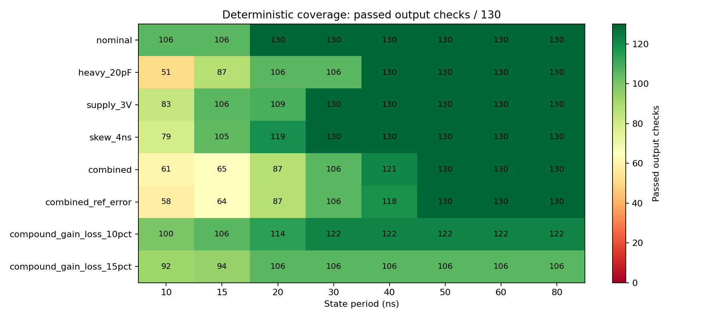

# 第八轮：可靠性边界与可靠运行代价

## 1. 结论

本轮确实运行了开源 ngspice：64次静态求解、88组连续瞬态、11,440个输出检查。
没有求解失败或日志警告；独立核验从原始波形重算全部检查及供电积分，结果为 PASS。
静态正确状态为60/64，失败没有筛除。

最重要的结果不是“通过次数更多”，而是区分了两类失败：

- **时序失败**：在指定工况中，延长周期可以让被测输出进入稳定窗口。
- **静态逻辑失败**：复合增益偏差已经让正确答案落到错误阈值侧，降频不能修复。

所测名义工况最低通过网格周期为20 ns，重负载为40 ns，组合扰动为50 ns。
两个更强的复合增益偏差工况在80 ns仍未全部通过，且工作点求解已确认稳定输出错误。

**这些结果限定于单比特基带代理模型。没有证明完整电磁计算机可靠，也没有证明整机能效优于数字电路。**

## 2. 实际模型与验证范围

沿用第七轮：第一阶段叠加 -> 有限偏置MOS进位判决 -> 真实进位输出RC支路
-> 第二阶段抵消 -> MOS和位判决。
每通道9个通用Level-1 MOS，共用电阻分压偏置；输入RC和节点电容、输出负载均沿用原模型。
两路判决使用1.6 V和1.2 V参考，编码为1.0 V基准、0.4 V/逻辑单位。
器件温度变化沿用假设温度系数，不是测得工艺参数。

输入使用1 ns线性过渡。Euler路径含65个状态时隙，覆盖全部64种有向状态跳转，
包括自跳转；初始时隙也验收，因此每组有130个输出检查。
这是同一指定顺序下的完整跳转覆盖，不是所有历史序列、所有输入波形的穷举。

主扫描使用200 ps最大步长、梯形法，周期网格为：

`10 / 15 / 20 / 30 / 40 / 50 / 60 / 80 ns`

每工况8组主扫描；最低通过网格点另做100 ps、50 ps梯形法及100 ps Gear法交叉检查。
无通过点的工况在80 ns交叉检查，以确认失败可复现。

### 工况定义

| 数据标签 | 修改内容 |
|---|---|
| nominal | 3.3 V供电、300 K、1 pF输出负载，其他沿用第七轮名义参数 |
| heavy_20pF | 两通道输出负载20 pF |
| supply_3V | 供电降至3.0 V |
| skew_4ns | 三输入边沿分别延后0/2/4 ns |
| combined | 使用第五轮介电常数增加1%的标定；3.0 V、20 pF；输入器件330 K、输入VTO额外+6.5 mV；两阶段共用路径缩放(1.05,0.95,1.05)，额外抵消增益×1.05 |
| combined_ref_error | combined再加进位参考+25 mV、和位参考−25 mV |
| compound_gain_loss_10pct | 第一阶段路径缩放(0.9,0.9,1.1)，第二阶段(1.1,1.1,0.9)，额外抵消增益×0.9 |
| compound_gain_loss_15pct | 两阶段路径均缩放(1.15,1.15,0.85)，额外抵消增益×0.85 |

这是8个明确指定的确定性工况，**不是所有参数角点或蒙特卡洛概率模型**。

## 3. 正确性判据

期望进位和和位由全加器真值生成，仅用于验收，不驱动求解电路。

- 期望1：输出至少为0.7 Vdd。
- 期望0：输出至多为0.3 Vdd。
- 采样点：每时隙90%处插值检查。
- 稳定窗口：时隙最后20%的全部已归档时间点均满足正确电平。
- 通过：采样点与稳定窗口同时正确。

“最后一次坏点后的首次正确点”记录为观测建立时间；时隙结束仍坏则记为未稳定。
它不是无限时间保持证明，也不是实物时钟的建立/保持时间或亚稳态测试。

### 为什么不能只检查单个采样点

| 工况 | 90%采样点通过 | 同时要求末段窗口通过 |
|---|---:|---:|
| nominal，15 ns | 130/130 | 106/130 |
| combined，40 ns | 130/130 | 121/130 |

例如名义15 ns时，最长观测建立约13.30 ns。90%采样发生在13.5 ns，
但末段窗口从12 ns开始，因此单点全通过仍不能说明这段窗口内稳定。

## 4. 周期与局部能量边界

下表电气数值取候选周期的100 ps梯形法；失败工况取80 ns。
“最低周期”只指所测网格最低通过点，不是连续频率边界或全工况保证值。

| 工况 | 静态正确状态 | 最低通过网格周期 | 局部平均Vdd功率 | 每状态周期Vdd能量 | 最小末段电平裕量 |
|---|---:|---:|---:|---:|---:|
| nominal | 8/8 | 20 ns | 1.746 mW | 34.92 pJ | 0.984 V |
| heavy_20pF | 8/8 | 40 ns | 4.190 mW | 167.58 pJ | 0.755 V |
| supply_3V | 8/8 | 30 ns | 1.198 mW | 35.93 pJ | 0.894 V |
| skew_4ns | 8/8 | 30 ns | 1.459 mW | 43.76 pJ | 0.984 V |
| combined | 8/8 | 50 ns | 2.889 mW | 144.43 pJ | 0.648 V |
| combined_ref_error | 8/8 | 50 ns | 2.891 mW | 144.55 pJ | 0.450 V |
| compound_gain_loss_10pct | 7/8 | 网格中无；80 ns仍122/130 | 1.024 mW | 81.94 pJ，含错误状态 | −2.304 V |
| compound_gain_loss_15pct | 5/8 | 网格中无；80 ns仍106/130 | 0.957 mW | 76.54 pJ，含错误状态 | −2.304 V |

前6个工况的候选周期在3组交叉检查中均为130/130。
后2个工况的失败同样可在不同步长和Gear法下复现，不能把更低功率当成有效计算优势。

从名义到combined：状态更新速率由5000万/秒降到2000万/秒，是原来的40%；
每状态周期局部能量约增至4.14倍。负载、供电和器件条件也同时变化，
**该比值不是单独由“降频”造成的实验归因**。



## 5. 静态错误为什么不能靠降频修复

10%复合偏差工况中，状态`110`应输出进位1、和位0，实际和位输出约3.294 V。
15%复合偏差工况中，`011 / 101 / 110`三种状态的和位均错误地输出约3.294 V。

以10%工况、`110`和理想标准进位电平为例，第二阶段归一化量近似为：

\[
z = 1.1 + 1.1 - 2(0.9)(0.9) = 0.58
\]

和位阈值为0.5，所以稳定判决本身就成为1，而正确和位是0。
实际进位高电平略低于3.3 V，会进一步减弱抵消；数值求解与这个机制一致。

这里两个0.9因子分别来自第二阶段C路径与额外抵消链增益，乘积0.81意味着
该抵消系数相对名义值减少19%。因此**不等同于“所有有效路径误差均不超过10%”**，
不能用来否定第五轮在既定误差模型下的充分条件`4δ + ε < 0.5`。

工程含义：必须约束或标定完整抵消增益、标准输出电平及阈值；
仅延长等待时间不能恢复已经跨错阈值的答案。

## 6. 对计算效率意味着什么

这里只能做条件性预算，不能从一个状态周期直接宣称完整整数算术性能。
沿用第五轮单元次数，假设单个单元顺序复用、无额外控制等待：

| 运算 | 单元次数 | 名义20 ns外推 | combined 50 ns外推 |
|---|---:|---:|---:|
| 4位加法 | 4 | 80 ns，1250万次/秒 | 200 ns，500万次/秒 |
| 5位有符号减法 | 5 | 100 ns，1000万次/秒 | 250 ns，400万次/秒 |
| 4位输入乘法 | 32 | 640 ns，156.25万次/秒 | 1600 ns，62.5万次/秒 |
| 商余除法 | 40 | 800 ns，125万次/秒 | 2000 ns，50万次/秒 |

这不是多位联合瞬态仿真，寄存器、路由、实际射频接口和控制延迟均未包含。
算术序列与本轮Euler输入序列的功率均值也未必相同。

### 未计入接口功率的敏感性

用`E = (P_Vdd + P_未知模块) × 4T`估算串行4位加法，只考察遗漏功耗的影响：

| 假设未计入模块功率 | 名义80 ns加法能量预算 | combined 200 ns加法能量预算 |
|---|---:|---:|
| 0 mW | 0.140 nJ | 0.578 nJ |
| 10 mW | 0.940 nJ | 2.578 nJ |
| 100 mW | 8.140 nJ | 20.578 nJ |
| 1000 mW | 80.140 nJ | 200.578 nJ |

以上功率是假设参数，不是RF测量，也不是本系统真实功率范围。
尚未计入接口的能量一旦较大，就会淹没局部判决链的低功耗优势。
当前既不能证明整机省电，也没有同位宽数字加法器的对照数据。

## 7. 数值核验与局限

独立核验不调用原测试的`measure()`，检查了：

- 静态真值、30%/70%电平裕量及64个状态行。
- 全64种有向跳转覆盖、11,440个输出行与原始波形对应关系。
- 时间轴单调、终点、最大步长、所有归档数组有限。
- 单点采样、末段窗口、建立时间、未稳定及保持同值时的瞬态越界。
- Vdd功率积分、每周期能量、候选网格点、交叉检查结论。

16对100 ps基准与50 ps/Gear比较中，供电能量相对差异最大约0.0114%；
进位波形最大插值差约13.21 mV，和位约17.68 mV。
这支持当前测试点结论的数值可复现性，不是严格误差上界或高阶收敛证明。
主扫描中尚未通过的更短周期，没有逐一做全部步长交叉检查。

仍未覆盖：

- 真实电磁传播/相干检波联合瞬态；本轮没有新增FDTD求解。
- 理想线性受控源、输入源、参考源的实际供能与噪声。
- 工艺实测模型、随机噪声、概率误码、老化、长时间运行、所有误差角点。
- 真实采样时钟、锁存器、建立/保持、亚稳态及多位连续计算。

有限个测试点零失败不能推导“物理系统100%正确”，也不能给出实物可靠性概率。

## 8. 下一步决策

1. 明确完整增益链的误差预算，优先验证抵消电平标定和错误检测。
2. 进行4位串行、并行和同位宽数字基准比较，计入可靠时序与已建模供电开销。
3. 只有性能有价值后，再投入真实RF接口、硬件保持/时钟和多位联合验证。

当前不应继续通过降频来追求所有误差工况都通过；本轮已经发现需要修正
增益链或判决设计的稳定错误。

## 9. 数据与复现

本轮源代码：

- `../run_reliability.py`：模型参数扫描。
- `../verify_reliability.py`：独立核验、表格和图。

结果：

- `reliability_summary.json`：版本、求解器SHA-256、工况、全部88组摘要和限制。
- `reliability_static.csv`：64个静态状态，包含失败。
- `reliability_decisions.csv`：11,440个输出检查。
- `reliability_case_table.csv`：每组周期、通过数、建立时间、局部供电能量。
- `reliability_boundaries.csv`：各工况网格候选及静态正确性。
- `reliability_verification.json`：核验结果与16对数值比较。
- `interface_power_sensitivity.csv`：明确假设下的接口功耗敏感性。
- 各工况`*.npz`：原始波形；`nominal_candidate.cir`、`combined_candidate.cir`：可重跑候选网表。

PowerShell：

```powershell
$env:PYTHONPYCACHEPREFIX = Join-Path $env:TEMP 'ewc-openems\pycache'
python "d:\work\trae_cn\电磁波计算机构想\开源FDTD验证\run_reliability.py" --executable "$env:TEMP\ewc-openems\ngspice47\Spice64\bin\ngspice_con.exe"
python "d:\work\trae_cn\电磁波计算机构想\开源FDTD验证\verify_reliability.py"
```

版本为ngspice-47，上游开源求解器；Python只配置电路和验收数据，没有自行实现电路推进。
依赖沿用既有NumPy和Matplotlib环境，未修改Windows安全策略。
